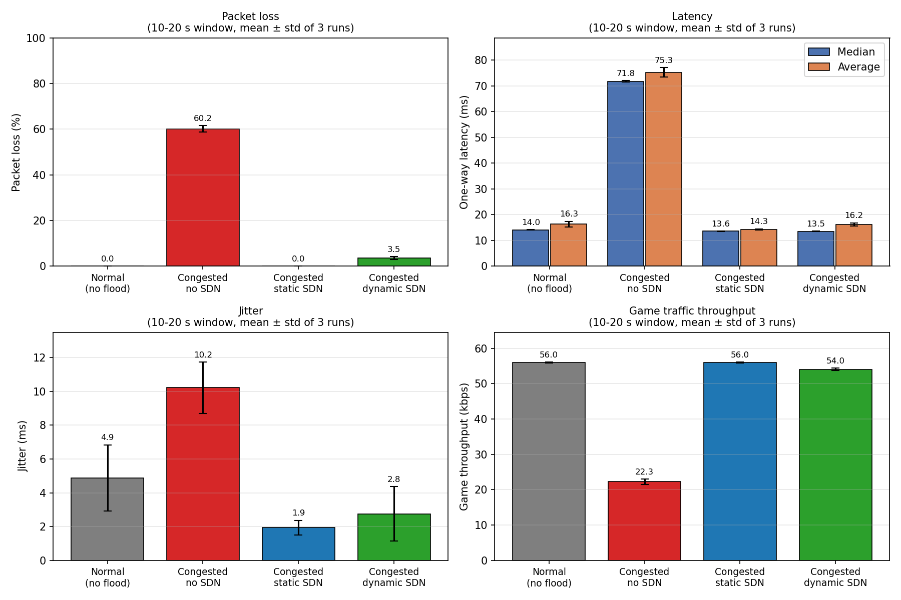
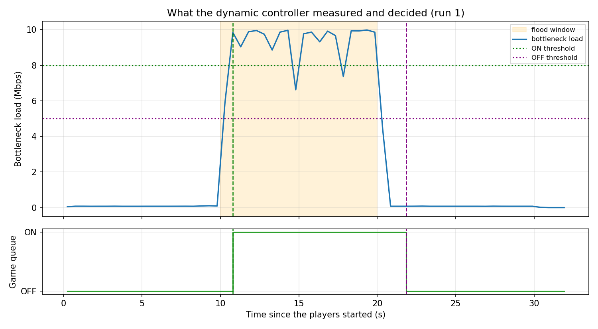
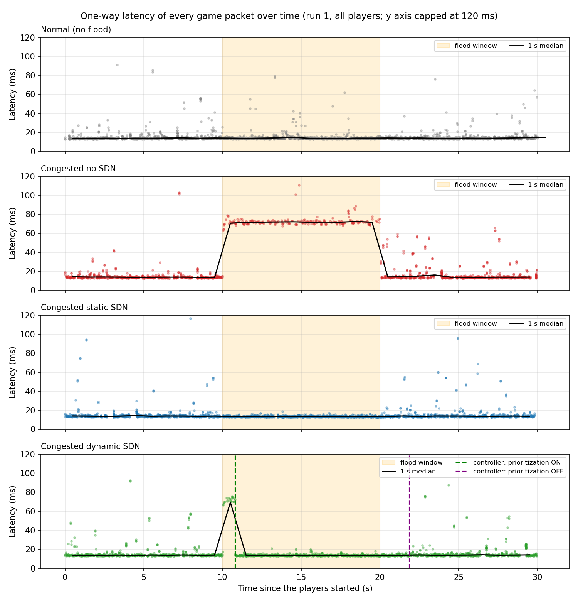

# SDN-Based Multiplayer Game Communication System

Jackfruit Mini Project (SDN + Socket Programming)
Name / Team: _<fill in>_ | Repo: https://github.com/BlueCow6636/sdn-game-project

**Status:** Deliverable 1 and Deliverable 2 are complete.

---

## 1. What this project does

Simulated players send their game position to a game server over **UDP**. Everything runs inside a **Mininet** network with two **Open vSwitch** switches, managed by a **Ryu** (OpenFlow 1.3) controller.

When a flood of background traffic congests the network, the controller notices and gives game packets a fast queue, so the game keeps working. We measured this against two baselines: no prioritization, and always-on prioritization.

- **Simulated:** the players and their X, Y and HP values.
- **Real:** the UDP packets, the links, the queues, the switches and the flow rules.

## 2. Results at a glance

Flood window (10 to 20 s of each 30 s run), average of 3 runs, 3 players, 20 Mbps UDP flood on a 10 Mbps link:

| Condition | Packet loss | Median latency | Game throughput |
|---|---|---|---|
| Normal (no flood) | 0.00% | 14.03 ms | 55.97 kbps |
| Congested, **no SDN** | **60.17%** | **71.81 ms** | **22.28 kbps** |
| Congested, static SDN (queue always on) | 0.00% | 13.56 ms | 55.98 kbps |
| Congested, **dynamic SDN** (controller decides) | 3.50% | 13.52 ms | 54.05 kbps |

Without prioritization the flood destroys about 60% of the game packets. With SDN prioritization the game behaves almost as on a quiet network. Dynamic loses about 3.5% because the controller needs about 0.8 s to notice the congestion (estimated from the graphs). Full numbers, including standard deviations, are in `results/summary.csv`.



## 3. How it is connected

```
                    Ryu controller
     (sends rules, polls port statistics, listens to the game server)
                          |
              +-----------+-----------+
              |                       |
  h1, h2, h3 (players) --+                          +-- hserver (game server)
  h4 (sends the flood) --+--- s1 ====10 Mbps==== s2 -+-- hsink  (flood sink)
                          (OVS queues on s1-eth5)    +-- root   (the VM, 10.0.0.200)
```

| Node | IP | Role |
|---|---|---|
| h1 to h3 | 10.0.0.1 to 10.0.0.3 | Players |
| h4 | 10.0.0.4 | Sends the background flood |
| hserver | 10.0.0.100 | Game server |
| hsink | 10.0.0.101 | Receives the flood |
| root | 10.0.0.200 | The VM itself, so the server can send messages to Ryu |

- The link between s1 and s2 is the **bottleneck**: 10 Mbps, with two queues created by Open vSwitch on port `s1-eth5`.
- Host links are 100 Mbps with 1 ms delay. The server link has 11 ms delay, so a player-to-server packet takes about 12 ms on a quiet network.
- The delay sits on the server link (not on the bottleneck) because Open vSwitch replaces the traffic-control setup on a port it manages.

## 4. How it works, step by step

1. A player sends `REGISTER` to the server. The server remembers its IP and port and replies `REGISTER_ACK`.
2. The server tells the controller (`PLAYER_REGISTER`), and the controller installs rules for that player on both switches.
3. Each player sends its position 20 times a second. Every update has a **sequence number** (1, 2, 3, ...) and a timestamp.
4. The server checks the sequence numbers. If it sees 5 and then 7, packet 6 was lost. It measures latency and jitter and forwards the update to the other players.
5. If loss in a 5-second window is above 5%, the server sends a `LOSS_ALERT` to the controller.
6. The controller watches the load on the bottleneck port. When the link is saturated, it sends game packets to the fast queue. When the load falls, it stops.

**Why lost packets are not re-sent:** a re-sent old position would arrive after newer ones and make the player jump backwards. So we count the loss but never retransmit.

## 5. Flow rules and queues

| Priority | Matches | Actions | Created |
|---|---|---|---|
| 1 | All traffic | `NORMAL` | When a switch connects |
| 100 | UDP port 5000 (game traffic) | `NORMAL`, with `set_queue 1` while prioritization is ON | When a switch connects |
| 200 | Game traffic to or from one registered player | same as priority 100 | When the server reports the player |

The highest priority number wins. `NORMAL` means "forward like an ordinary learning switch".

**Queues on the bottleneck port** (created by `topo/topology.py` with Open vSwitch QoS, type `linux-htb`, 10 Mbps total):

| Queue | Used by | Guaranteed rate | Priority |
|---|---|---|---|
| 0 (default) | Background traffic | 1 Mbps | lower |
| 1 (game) | Game packets sent with `set_queue 1` | 2 Mbps | higher |

Each queue holds 50 packets. OpenFlow rule priority only decides which rule matches. It is the **queue** that makes game packets skip the line.

## 6. Dynamic prioritization

The controller asks switch s1 for **port statistics** every 0.5 s and works out how much traffic left the bottleneck port.

- **ON:** load is at least 80% of 10 Mbps (8 Mbps). The controller reinstalls the game rules with `set_queue 1`.
- **OFF:** load stays below 50% for 4 polls in a row (about 2 s). The rules go back to plain `NORMAL`.
- Two different thresholds (hysteresis) stop the controller from switching on and off repeatedly.
- Every poll and decision is written to `results/controller_log.csv`.

Three modes, chosen with the `PRIORITY` environment variable when Ryu starts: `dynamic` (default), `on` (always on, static) and `off` (never, the baseline).



## 7. Files

```
sdn_game_project/
├── server/game_server.py          Game server: registration, sequence numbers, loss, latency, jitter, controller events
├── client/player.py               A player: simulated movement over UDP
├── topo/topology.py               Mininet topology and the Open vSwitch queues
├── controller/sdn_controller.py   Ryu controller: rules, monitoring, dynamic decisions
├── traffic/background_traffic.py  Flood generator (iperf3)
├── experiments/run_experiments.py Runs all experiments automatically (also: .mn files for manual runs)
├── analysis/analyze_results.py    Draws the graphs
├── analysis/phase_stats.py        Per-phase table from one packet log
├── results/                       CSV results, summary.csv, raw/ logs, graphs/
├── docs/screenshots/              Test evidence
└── README.md  START.md
```

## 8. Install (Ubuntu)

```bash
sudo apt update
sudo apt install -y python3 python3-pip python3-venv curl mininet openvswitch-switch iperf3 iproute2 net-tools python3-matplotlib python3-pandas
sudo systemctl enable --now openvswitch-switch
```
If iperf3 asks whether to start as a daemon, answer **No**.

Ryu needs Python 3.9, so it goes in its own environment:

```bash
curl -LsSf https://astral.sh/uv/install.sh | sh
source ~/.local/bin/env
uv venv --seed --python 3.9 ~/ryu-venv
source ~/ryu-venv/bin/activate
pip install "setuptools==65.5.0" wheel pbr "eventlet==0.30.2"
pip install ryu --no-build-isolation
ryu-manager --version
deactivate
```

## 9. Run it

**Option A: all experiments automatically (about 10 minutes)**

Close any running Ryu and Mininet first, then:

```bash
cd ~/sdn_game_project
sudo python3 experiments/run_experiments.py
python3 analysis/analyze_results.py
```
The script starts Ryu and Mininet itself for each condition. Results go to `results/`, graphs to `results/graphs/`. A single condition can be run with `--conditions congested_sdn_dynamic --runs 1`.

**Option B: manual run (for a live demo)**

Clean up first, then start Ryu, then Mininet. Never run `sudo mn -c` while Ryu is running.

```bash
sudo mn -c
```
Terminal 1:
```bash
source ~/ryu-venv/bin/activate
cd ~/sdn_game_project
ryu-manager controller/sdn_controller.py --verbose
```
Terminal 2:
```bash
cd ~/sdn_game_project
sudo python3 topo/topology.py --controller-port 6653
```
Wait for Ryu to print `[SWITCH JOINED]` twice and `[MONITOR] bottleneck s1-eth5`, then at `mininet>`:
```
pingall
source experiments/congested_sdn_dynamic_run1.mn
```
Watch Terminal 1 for `CONGESTION DETECTED` and then `CONGESTION CLEARED`. See `START.md` for the full command list.

## 10. The experiments

Four conditions, each repeated 3 times, 30 s per run, 3 players at 20 updates per second:

| Condition | Flood | Controller mode |
|---|---|---|
| `normal` (Experiment A) | none | off |
| `congested_no_sdn` (Experiment B) | 20 Mbps UDP | off |
| `congested_sdn_static` | 20 Mbps UDP | on (always) |
| `congested_sdn_dynamic` (Experiment C) | 20 Mbps UDP | dynamic |

Each run: 0 to 10 s players only, 10 to 20 s players plus the flood (the same window is measured in `normal`), 20 to 30 s players only.

**Metrics** (measured by the server from real packets, nothing is invented):
- **Packet loss** = (expected - received) / expected x 100, from sequence numbers.
- **Latency** = one-way, server receive time minus the player's send timestamp. All Mininet hosts share one clock, so this is valid.
- **Jitter** = average of |latency[n] - latency[n-1]| over consecutive received packets.
- **Throughput** = game bytes delivered x 8 / time.

**Output files:** `results/<condition>.csv` (one row per run and phase), `results/summary.csv` (mean and standard deviation), and `results/raw/` (every packet, the server summaries, the controller log and the Ryu log for each run).

## 11. Graphs

| Graph | Shows |
|---|---|
| `results/graphs/avg_latency.png` | Average and median latency |
| `results/graphs/jitter.png` | Jitter |
| `results/graphs/packet_loss.png` | Packet loss |
| `results/graphs/throughput.png` | Game throughput |
| `results/graphs/latency_over_time.png` | Latency of every packet over time, with the controller's ON/OFF moments |
| `results/graphs/latency_over_time_medians.png` | 1-second median latency, all conditions on one chart |
| `results/graphs/controller_decisions.png` | What the controller measured and decided |
| `results/graphs/overview.png` | The four main metrics together |



## 12. Tests

**Deliverable 1**

| Test | How | Result | Evidence |
|---|---|---|---|
| Switches connect to Ryu | `sh ovs-vsctl show` | `is_connected: true` on both | `d1_03_ovs_controller_connected.png` |
| Connectivity | `pingall` | 0% dropped | `d1_04_pingall_0_dropped.png` |
| Registration and loss counting | server log | each player 200 received, 0 lost | `d1_05_server_registration_loss.png` |
| Server tells controller | Ryu log | `[APP EVENT]` per player | `d1_06_ryu_app_events.png` |
| Rules created from events | `dump-flows` during the game | priority-200 rules with packet counts | `d1_07_flows_s1_priority200.png`, `d1_08_flows_s2_priority200.png` |

**Deliverable 2**

| Test | How | Result |
|---|---|---|
| Queues exist | `sh ovs-vsctl list qos` | `linux-htb` with queues 0 and 1 |
| Congestion hurts without SDN | `congested_no_sdn` | 60.17% loss, 71.81 ms median latency |
| Static prioritization works | `congested_sdn_static` | 0.00% loss, 13.56 ms; the game queue carried 1,202 packets in a manual 2-player run |
| Dynamic prioritization works | `congested_sdn_dynamic` | 3.50% loss, 13.52 ms; Ryu logs `CONGESTION DETECTED` then `CLEARED` |
| Queue used only while congested | `tc -s class show dev s1-eth5` | game queue carried 462 packets in a manual dynamic run (1,202 in static) |
| Loss alert | Ryu log under congestion | `LOSS ALERT` lines (`d2_06_loss_alerts_in_ryu.png`) |
| Repeatability | 3 runs per condition | `results/summary.csv` |

Further evidence: `d2_10_full_run_summary.png`, `d2_11_overview.png`, `d2_12_latency_over_time.png`, `d2_13_controller_decisions.png`.

## 13. Limitations (honest)

- **Everything runs on one VM.** Latency has occasional spikes of 100 ms or more from VM scheduling, so we base conclusions on loss, median latency and throughput.
- **Jitter is not reliable here.** The same condition (Normal) gave 8.6 ms in one set of runs and 4.9 ms in another.
- **Only 3 runs per condition.** The standard deviations in `summary.csv` show the spread.
- **Static was slightly better than dynamic** in our results, because always using the game queue costs nothing in this setup. Dynamic's value is that it reacts to measured congestion and acts only when needed. Its cost is the reaction time of about 0.8 s (estimated, because the flood start is not timestamped exactly).
- **Detection is based on link load**, not on actual queue length or drops. A link running at 80% or more is treated as congested.
- **Any UDP traffic on port 5000 gets priority.** There is no check of who sends it.
- **The loss alert only gets logged.** The controller does not act on it yet.
- **Only the s1 to s2 direction is shaped.** Return traffic from the server is light and not limited.
- **The delay is on the server link**, not on the bottleneck, as explained in section 3.
- **Not tested:** random packet loss on the links, link failure and server overload.
- **`client/player.py --csv` is not used.** All measurements come from the server.

## 14. Troubleshooting

| Problem | Fix |
|---|---|
| `ryu-manager: command not found` | Run `source ~/ryu-venv/bin/activate` first |
| `pingall` shows X or 100% loss | Ryu is not connected. Check you did not run `sudo mn -c` after starting Ryu (it kills Ryu). Restart in the order: `sudo mn -c`, Ryu, Mininet |
| No `[MONITOR] bottleneck` line in Ryu | The port name was not found. The warning lists the ports it saw. Use `BOTTLENECK_PORT=<number>` or `BOTTLENECK_IF=<name>` |
| `Address already in use` on 5000 | `sh pkill -f game_server.py` |
| `Address already in use` on 6653 or 9999 | `sudo pkill -f ryu-manager` |
| `Unknown OpenFlow version` | Write `OpenFlow13` with no space |
| `sch_htb: quantum of class ... is big` | A harmless warning from Linux traffic control |
| `ModuleNotFoundError: ryu` | Start the controller with `ryu-manager`, not `python3` or `sudo` |
| `apt` waits for a lock | Ubuntu's updater is running. Wait for it to finish |
| Dynamic run shows no prioritization | Check Ryu printed `[MODE] dynamic` and the `[MONITOR]` line. Look at `results/controller_log.csv` |
